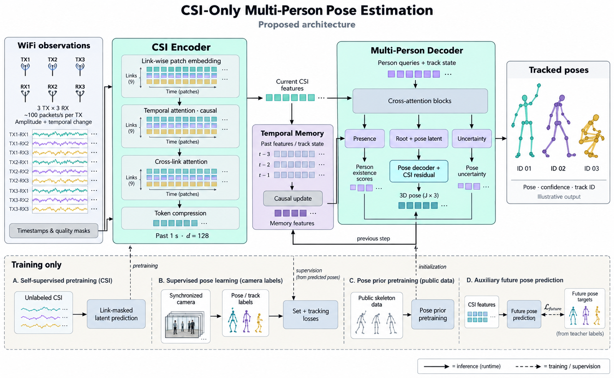

# CSI multiperson — S00–S07 / V00

ESP32 TX3×RX3 CSI를 위한 새 패키지입니다. 현재 구현 범위는 설정·공통 계약·CSIRAW01/130B 파서·RX/TX epoch 판정·인과적 RX 시계 변환·읽기 전용 세션 importer·10ms/100슬롯 causal grid/window·로그진폭/변화량 특징과 유효성 mask·초기 15개 계측과 화면 출력 계약입니다. 합성 fixture로 검증하며, 정규화 통계 적합과 고정 통계 적용은 S11 분할 이후 작업입니다. 모델·실장치 수집·브라우저 화면도 후속 단계입니다.

검증 결과: [S00–S03](reports/s00-s03-validation.json), [S04 시계](reports/s04-validation-v2.json), [S05 가져오기·저장](reports/s05-validation.json), [S06 causal grid/window](reports/s06-validation.json), [S07 특징 생성](reports/s07-validation.json).

## 아키텍처



위 그림은 전체 설계안입니다. 그림의 모델 학습·다중 인원 자세 추론과 실장치 검증은 후속 단계이며, 현재 구현 범위는 아래 실행 방법과 API를 참고하세요.

## 실행

아래 명령은 `csi-multiperson/`에서 실행합니다. Python 3.11 이상이 필요합니다. 이번 작업에서는 기존 NumPy/PyYAML/pytest를 공유하는 `.venv`에 editable 설치를 검증했습니다.

```bash
rtk proxy python -m venv --system-site-packages .venv
rtk proxy .venv/bin/python -m pip install --no-build-isolation --no-deps -e .
rtk proxy .venv/bin/python -m csi_mp --help
rtk proxy .venv/bin/python -m csi_mp validate-config --config configs/capture.yaml
rtk proxy .venv/bin/python -m csi_mp inspect --config configs/capture.yaml
rtk proxy .venv/bin/python -m csi_mp inspect --config configs/capture.yaml --save
```

NumPy/PyYAML/pytest가 없는 새 환경에서는 일반 가상환경 생성 후 `rtk proxy .venv/bin/python -m pip install -e '.[dev]'`로 설치합니다. `dataset`, `teacher`, `train`, `live` 추가 의존성은 분리되어 있습니다. 도움말과 ingest 검사는 Torch·카메라·교사 모델을 로드하지 않습니다.

`inspect` 기본 동작은 원본을 읽고 JSON 요약을 stdout에 출력합니다. `--save`는 설정의 `output_dir/run_id`, `--output PATH`는 지정한 새 폴더에 보고서를 기록합니다. 이미 존재하는 경로는 오류로 거부합니다. 실패 시 새 출력 폴더에 `failure.json`과 그때까지의 진단을 남깁니다. 참조 폴더 `examples/`, `ex)robot/`는 출력 대상으로 허용하지 않습니다.

보고서는 `manifest.json`, `config.resolved.json`, `frames.jsonl`, `issues.jsonl`, `epochs.jsonl`, `metrics.jsonl`, 최종 `metrics.json`, `dashboard.json`으로 구성됩니다. frame 기록에는 wire 원형, signed IQ, 원본 byte span, 완성 시각, epoch·사용 가능 여부와 `timing`을 포함합니다. `timing`에는 불변 acquisition/availability, 공통 clock domain·기준점, 모델 ID·추정 잔차·warmup·제외 사유가 들어갑니다. manifest는 clock policy·최종 snapshot·상태별 계수도 보존합니다. 원본·설정·구현·계측 정의·provider·선택 목록의 hash를 보존합니다.

`measurement.sinks: []`는 주기적인 `metrics.jsonl` 기록을 끕니다. 최종 `metrics.json`·`dashboard.json`은 실행 검토용 계약 snapshot으로 남깁니다. 현재 지원하는 streaming sink는 `jsonl`이며 dashboard 전송은 V01 이후에 연결합니다. 모든 writer를 닫고 최종 파일 기록에 성공한 뒤에만 완료 manifest를 발행합니다.

## 재현 가능한 세션 가져오기

```bash
rtk proxy .venv/bin/python -m csi_mp import --config configs/capture.yaml --output runs/ingest-v1.csisession
```

`import`는 새 `.csisession` SQLite 파일에 원본 전체 bytes와 SHA256, 관측·epoch·시각·진단·제어 근거를 보존합니다. 원본의 junk와 미완성 꼬리도 포함합니다. manifest에는 설정·구현·record hash, I/Q·SC 순서의 확인 상태, 시계 정책·가정을 남깁니다. 같은 원본·설정으로 다시 가져오면 관측과 계보가 같고, 현재 검증 환경에서는 파일 bytes도 같습니다. grid·특징·T100 window는 아직 생성하지 않습니다.

raw 경로는 S02–S04를 재사용합니다. 기존 HDF5는 선택 의존성 `h5py`가 필요하며, `capture.sources`에 다음처럼 별도 형식을 지정합니다. 경로는 YAML 파일 기준입니다.

```yaml
capture:
  session_id: legacy-session
  sources:
    - source_id: legacy
      path: ../data/recording.h5
      format: legacy_hdf5
      clock_domain: bridge:recording-host
```

`rx_id`는 HDF5 `/links/{rx}{tx}`에서 읽습니다. `clock_domain`을 모르면 생략하며 `t_ns`는 원래 Unix wall 값으로 보존합니다. 빠진 필드는 null과 사유를 남깁니다. `/links`에 없는 CRC·wire 원형·확정 epoch·acquisition·availability를 만들어 넣지 않으며, 보존한 행은 인과적 입력에 사용 가능하다고 표시하지 않습니다. `/samples/X`만 있는 자료, 손상 shape/dtype/행 수, 외부 파일에 의존하는 HDF5는 거부합니다. raw와 `/links`는 별도 세션으로 가져옵니다.

임시 파일을 닫고 schema·개수·hash와 원본 불변성을 검증한 뒤 같은 filesystem의 hard link로 최종 경로를 원자적으로 확정합니다. 기존 목적지와 경쟁 writer의 결과는 덮어쓰지 않습니다. 실패·중단 기록은 형제 경로 `.파일명.importing/state.json`에 남으며 재시도를 막습니다. 해당 작업이 실행 중인지와 기록을 확인한 뒤 staging 폴더를 따로 보존하거나 제거하고 재시도합니다. 성공한 작업은 staging을 정리합니다.

Python API는 `import_session(source, destination, spec)`이며 `spec`은 `load_config(...)`의 `AppConfig`, `source=None`은 설정의 모든 원본을 뜻합니다. 읽기는 원본 경로 없이도 가능합니다.

```python
from csi_mp.data.store import SessionStore

with SessionStore.open_readonly("runs/ingest-v1.csisession") as session:
    manifest = session.manifest
    for observation in session.observations():
        timing = observation["timing"]
    # session.epochs(), session.issues(), session.records("controls")
    # session.source_bytes("rx0")는 원본 bytes를 chunk 단위로 반환합니다.
```

`open_readonly`는 완료 manifest와 저장 데이터의 schema·개수·hash를 검사하고 읽기 전용으로 엽니다. `MigrationReport.accepted_frames`는 보존한 형식 유효 관측 수이며, 실제 epoch·시계 사용 가능 여부는 `usable_frames`로 구분합니다. 기본 raw fixture는 13개 보존·10개 사용 가능·2개 epoch 미확정입니다.

## Causal grid/window API

`csi_mp.data.grid.CausalGridBuilder`는 S04의 `TimedObservation`을 받아 기본10ms 간격으로 슬롯을 한 번만 확정합니다. `ingest(observation)` → `commit_through(deadline_ns)` → `window_at(target_ns)` 순서로 사용합니다. 생성 시 session·첫 grid의 `Stamp`·provenance·availability basis와 `FeatureBuilder`를 명시합니다. `from_config(config, ...)`는 기존 model/input 설정을 연결합니다.

- 기본 window는 `[100,9,56,2]`이며 100개 실제 슬롯 전에는 `warming_up`입니다.
- acquisition과 arrival deadline을 모두 검사합니다. 늦은 패킷은 이후 적격 슬롯에서 사용할 수 있고, 이미 확정한 슬롯은 바꾸지 않습니다.
- `link_state`는 1=observed, 2=held, 0=unavailable입니다. hold는 기본30ms까지이며 delta를 0·invalid로 처리합니다. 결손은 모든 특징0·mask false·age−1입니다.
- epoch·clock 경계와 긴 결손은 hold·차분을 끊습니다. 현재 전 링크 결손은 `insufficient_coverage`이며 빈방을 뜻하지 않습니다.
- 최근100슬롯을 보관하고 반환 객체는 불변입니다. S07의 `csi_mp.data.features.FeatureBuilder`를 주입해 정규화 전 로그진폭·시간 변화량을 계산합니다. S06 테스트 변환은 fixture 전용입니다.

API·late counter·보관 규칙은 [구현](src/csi_mp/data/grid.py)과 [테스트](tests/test_causal_window.py), [S06 검증 결과](reports/s06-validation.json)를 참고하세요. importer는 계속 원시 세션만 저장하며 grid/features를 자동 실행하지 않습니다.

## 로그진폭·변화량 특징 API

`FeatureBuilder`의 채널 순서는 `amp`, `delta_amp`입니다. `amp=log1p(hypot(I,Q))`는 자연로그와 고정 +1을 사용하며 추가 epsilon을 넣지 않습니다. 변화량은 현재와 직전 실제 관측의 로그진폭 차이를 acquisition 경과초로 나눕니다. 큰 절대 시각에서도 정밀도를 잃지 않도록 정수 ns를 먼저 빼고, float64로 계산한 뒤 float32로 저장합니다.

0 I/Q는 유효 진폭0입니다. 첫 관측·held·reset·긴 결손·동일/역순 시각의 변화량은0·mask false이며, 동일/역순 관측은 전진 차분 기준을 바꾸지 않습니다. delta는 같은 링크·RX/TX epoch·link/clock segment·clock domain/kind 안에서 `0 < dt_ns <= max_delta_gap_ns`일 때만 유효합니다. 기본 상한은30ms이고 `FeatureBuilder.from_config(config)`는 grid의 `max_hold_age_ms`를 사용합니다.

```python
from csi_mp.config import load_config
from csi_mp.data.features import FeatureBuilder
from csi_mp.data.grid import CausalGridBuilder
from csi_mp.data.schema import Stamp

config = load_config("configs/capture.yaml")
features = FeatureBuilder.from_config(config)
grid = CausalGridBuilder.from_config(
    config,
    start=Stamp(0, "example-replay", "virtual"),
    feature_builder=features,
    provenance_id="example-replay",
    availability_basis="synthetic",
)
feature_manifest = features.spec.to_dict()
feature_spec_hash = features.spec.spec_hash
# 같은 clock과 availability basis의 TimedObservation을 grid.ingest(...)로 전달합니다.
# grid.commit_through(...) 뒤 grid.window_at(...)의 raw_x는 정규화 전 특징입니다.
```

`FeatureSpec`은 불변이고 `logamp_delta.v1` 수식·채널·mask·gap 정책을 manifest와 hash로 식별합니다. 파생 산출물 계보에는 이 manifest/hash와 grid 정책을 함께 남깁니다. provider는 링크별 최신 처리 관측의 snapshot만 보관하므로 grid처럼 `on_observation` 직후 조회하며, 오래된 ID는 오류입니다. 반환한 `SlotFeatures`는 이후 관측·reset에도 바뀌지 않습니다. `fit_stats`와 `FrozenFeatureNormalizer`는 아직 제공하지 않으며 S11의 train manifest 확정 후 구현합니다.

## Fixture와 검증

```bash
rtk proxy .venv/bin/python scripts/generate_fixtures.py
rtk proxy .venv/bin/python -m pytest -q
rtk proxy .venv/bin/python -m ruff check src tests scripts
```

[fixtures/ingest_v1/expected.json](fixtures/ingest_v1/expected.json)은 seed, 두 입력 파일의 SHA256, record별 시나리오, 파서와 독립적으로 구성한 예상 계수를 담습니다. 생성기는 같은 bytes를 재생성합니다.

| 항목 | 기대값 |
|---|---:|
| 완전 raw record / parser 입력 bytes | 16 / 1,990B |
| CRC·semantic 통과 frame | 13 |
| 고유 사용 가능 / 중복 / epoch 불확실 제외 frame | 10 / 1 / 2 |
| 고유 frame 중 역순 수신 | 1 |
| CRC 실패 후보 / semantic 거부 | 1 / 1 |
| junk / CRC resync bytes | 23B / 130B |
| raw record / wire frame 미완성 꼬리 | 15B / 17B |
| TX 재시작 추정 / RX 재시작 확인 | 1 / 1 |

CRC 후보 수와 버린 bytes는 단위가 달라 합산한 손실률을 만들지 않습니다. raw 꼬리는 reader가 yield하지 않아 parser bytes에 포함되지 않습니다. 동일 TX 순번을 RX0·RX1이 받으면 각각 고유 관측입니다.

## 설정과 해석

- YAML 우선순위는 `includes`의 순서 → 현재 파일 → `load_config(..., overrides=...)`입니다. 중첩 mapping을 병합하며 list는 교체합니다. 상대 경로는 선언한 YAML 파일 기준이고, 명시적 overrides는 주 설정 파일 기준입니다. CLI `--output` 경로는 실행 디렉터리 기준입니다. 환경변수는 설정을 변경하지 않습니다.
- 알 수 없는 설정 필드·metric ID, 잘못된 D/T/patch/Q, 미지원 schema/좌표 계약을 거부합니다. 설정 hash는 기본값과 경로를 해석한 내용에 대해 계산합니다. model Q는 라벨 저장 인원을 자르지 않습니다.
- 초기 선택은 `custom/ingest_v1` 15개 metric입니다. 미선택은 `disabled`, 미연결은 `not_measured`, GT 부재는 `no_gt`, 표본 부족은 `no_samples`, 형식·시계 제약은 `unsupported`로 직렬화합니다. 누적값과 최근 창, p5/p50/p95는 다른 series입니다.
- quantile은 nearest-rank이며 p50은 최소 1개, p5/p95는 최소 20개의 고유 관측이 필요합니다. 없는 값을 0으로 채우지 않습니다. 화면 ingest 상태는 `unknown`, 인원 `null`, persons `[]`입니다.
- RX boot와 TX seq epoch는 독립적입니다. 낮은 seq 하나는 제외하며, 기본 정책은 3개 진행 근거에서 `inferred` reset을 만듭니다. `tx_start`/`tx_reboot`/TX 범위의 `operator_boundary` 제어 근거는 `confirmed`입니다. 현재 기본 threshold는 `epochs_fixture_v1`이며 현장 검증값이 아닙니다.
- legacy 시각은 `unix_wall`입니다. 합성 fixture임은 별도 provenance로 표시합니다. 추론 도착 시각을 만들어 넣거나 서로 다른 clock을 직접 빼지 않습니다. 여러 raw 파일은 동일한 명시적 clock domain일 때만 inspect할 수 있습니다. 파일 내부 순서와 시각 후퇴 진단을 보존합니다.
- S04의 `OnlineClockMapper`는 RX epoch별 bounded affine fit을 도착순으로 갱신합니다. 이미 발행한 timestamp와 모델은 불변이며, reorder는 기존 fit으로 해석합니다. 다른 host clock은 API의 명시적 `ClockTransform`이 필요하고 legacy CLI에서 자동 보정하지 않습니다.
- `clock_fixture_v1`은 최근64개·warmup3개·최소10ms·최대 drift1000ppm의 개발 정책입니다. `warming_up`도 예비 추정값을 내보내므로 소비자는 `clock_status`를 확인해야 합니다. `clock_error_ns`는 bridge 잔차와 알려진 변환 오차이며 실제 acquisition 오차 상한이 아닙니다. 고정 통신 지연은 식별하지 못합니다.
- 실제 infer arrival이 있으면 `measured_infer`, 없으면 bridge 시각에 `clock.legacy_delay_ns`(기본0)를 더한 `legacy_bridge_proxy`입니다. `synthetic`은 별도 합성 근거를 표시합니다. host 시계 후퇴는 해당 frame을 제외하고 다음 frame부터 새로운 clock segment로 시작하며 +1ns 보정하지 않습니다.
- metric snapshot은 source 시각의 고정 주기 경계에서 생성합니다. 입력 없는 구간은 가장 최근 경계로 합치고 생략한 경계 수를 manifest에 남깁니다. EOF 요약을 추가합니다. 이 파일 재생 주기를 live 출력 Hz로 해석하지 않습니다.

## 다음 단계

다음은 S08 다중 인원 교사이며, 정규화 통계 적합과 고정 통계 적용은 S11 분할 후 진행합니다. grid 계측 provider와 실제 노출시간·성숙 순번 구간 계측은 별도 연결이 필요하며 pps·seq gap은 정의만 있고 초기 선택에서 비활성입니다. RAW dump(0xC51F), live arrival 수집, 실장치 threshold 검증, 모델 학습·정확도·지연 측정, V01 브라우저 화면도 아직 지원하지 않습니다.

기존 legacy wire에는 TX boot가 없고 RX boot는 8bit라 모든 지연 패킷의 epoch를 확정할 수 없습니다. 알려진 과거 wire 재전송은 격리하지만, 관측하지 못했던 과거 패킷에는 한계가 남습니다. 시계의 전진 점프와 실제 긴 수집 공백도 외부 근거 없이 구별하지 않습니다. 합격 기준은 `not_evaluated`로 남깁니다.
